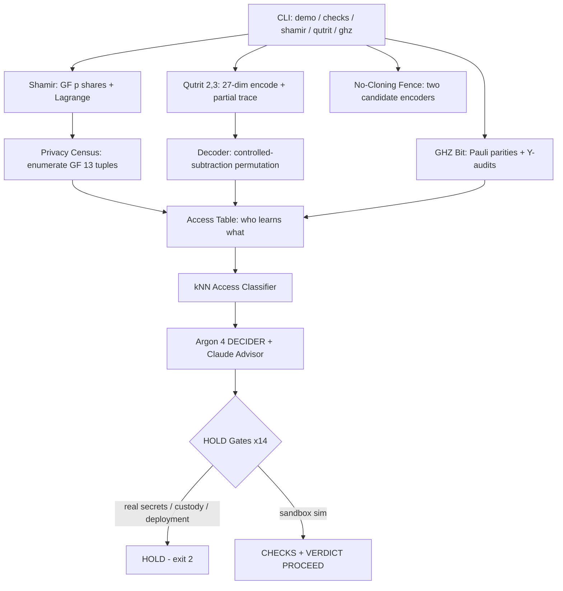
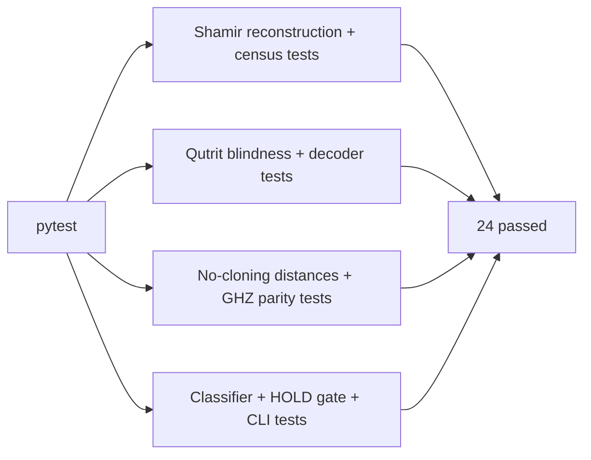
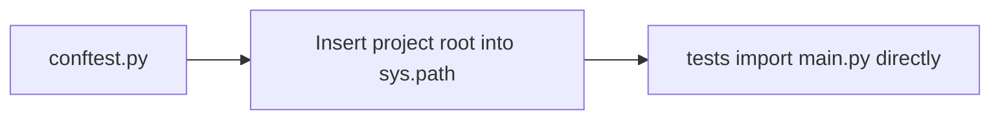
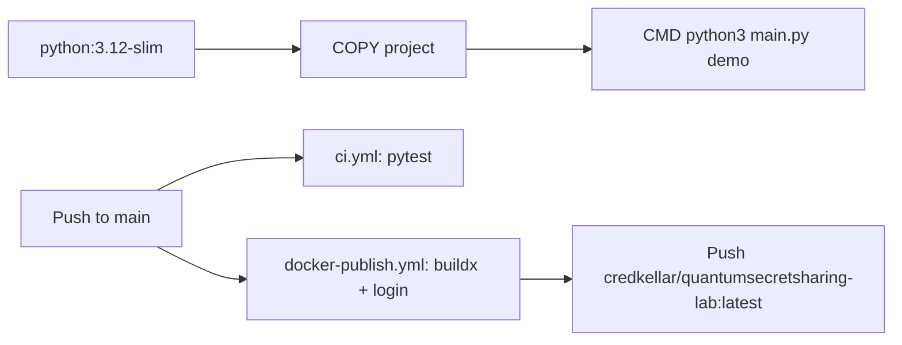

# QuantumSecretSharing-Lab 🔐⚛️

**Quantum Secret Sharing Lab — Shamir Thresholds, the Qutrit (2,3) Code & the No-Cloning Fence** — by Darion Kellar

QuantumSecretSharing-Lab is an **educational secret-sharing lab** in ONE pure-Python file. It builds three threshold constructions from scratch and grades each one against the exact statement it is supposed to satisfy:

- **Shamir (k, n) over GF(p)** — the classical scheme: a polynomial hides the secret as its constant term, any k shares rebuild it exactly, and k − 1 shares are consistent with *every* candidate secret — counted, not asserted, by a full enumeration census. 🔢
- **The qutrit (2, 3) quantum scheme** in its GHZ-style teaching form — a secret qutrit encoded as α|000⟩ + β|111⟩ + γ|222⟩ in a 27-dimensional statevector: one share is *exactly* phase-blind, and the decoder is exhibited as a basis permutation (controlled subtractions mod 3) that recovers the secret to 0.000e+00. ⚛️
- **The HBB-style GHZ bit scheme** — the secret bit lives in the X-parity of a three-qubit GHZ state; single parties see coin flips, and Y-parity audits catch a substituted product state with probability 1 − 2^−m. 🕵️

And it builds the **fence**: a computed toy demonstration of why a (2, 2) quantum scheme for an arbitrary qubit cannot exist — two candidate linear encoders, each perfectly reconstructable, each shown in trace distances to leak exactly the quadrature it tries to hide. That is the no-cloning obstruction wearing numbers, labelled a demonstration on two candidates, not a proof. 🚧

Honest scope, stated up front: **nothing here protects a real secret.** The demo's Shamir coefficients are derived deterministically from a labelled hash so the output is reproducible — a real dealer must use true randomness, and that difference is exactly why real-secret use is a permanent HOLD gate. No key is custodied, no data is secured, no quantum hardware exists here. Every deployment / custody / product claim sits behind a permanent HOLD gate (14 total). 🔒

[](https://github.com/kimanicollier44-cmyk/QuantumSecretSharing-Lab/actions/workflows/ci.yml)
[](https://github.com/kimanicollier44-cmyk/QuantumSecretSharing-Lab/actions/workflows/docker-publish.yml)

> ℹ️ These are the **live** workflow badges for this repo. They activate as soon as the `ci.yml` and `docker-publish.yml` files from the paste pack are pasted into `.github/workflows/` — until then they have nothing to report yet.

## 🧰 Tech Stack Badges & Full Architecture Tech Stack

### 💻 Core Programming Languages & Core Systems


-GF(257)-2ea44f)
-27--dim%20Code-2ea44f)

- 🐍 Python 3.12, pure standard library (`math`, `cmath`, `hashlib`, `json`, `sys`) — zero dependencies, zero network, deterministic (double-run byte-identical)
- 🔢 Shamir core from scratch: GF(p) polynomial shares, Lagrange interpolation at x = 0 with modular inverses, and a privacy **census** that enumerates every coefficient tuple over GF(13) and counts completions per candidate secret — perfect privacy is a tally, not a slogan
- ⚛️ Statevector core from scratch: partial traces by stride index arithmetic on 27-dim (qutrit), 8-dim (GHZ) and 4-dim (qubit) spaces, a decoder written as a pure basis permutation (controlled subtractions mod 3 as index maps), Pauli products by Kronecker multiplication, trace distances in closed form
- 🚧 No-cloning fence: two candidate linear encoders graded by computed single-share density matrices — cross terms Tr_B |a0⟩⟨a1| evaluated entry by entry, leaks reported as exact trace distances (0.000 / 0.500 / 1.000)
- 🧠 TinyML kNN access classifier (from scratch, stdlib, distance-weighted): reconstructable / locked-below-threshold / phase-blind-share / cheater-exposed from shares present + threshold + measured phase information + failed checks, labels from the lab's own access policy
- 🪑 Council seats: Gemini Argon 4 DECIDER (names-only, tighten-only) + Muse advisor (never overrides HOLD) + Google Flow plan-only (rendered = False, live = 0)

### ⛓️ Web3 & Infrastructure

- 🚫 **Not applicable — honestly.** No blockchain, no Web3, no tokens: the "infrastructure" in this lab is one offline file holding a finite field, a 27-dim statevector, and a parity table. Key custody and wallet schemes are permanent HOLD gates, not features. No fake badges here.

### ⚙️ Platform Support & Hardware Architecture


- 🖥️ Pure Python — runs anywhere Python 3.12+ runs (Linux, macOS, Windows), plus the `python:3.12-slim` Docker image
- 🔒 No hardware is controlled, ever: real quantum devices, HSMs, and key stores are permanent HOLD gates (see the gate table below)

### ⚡ Low-Level Infrastructure & Performance

- 🚫 **No low-level code — honestly.** No C, no C++, no GPU, no compiled extensions: this is one interpreted Python file on purpose, so every share, density matrix, and parity can be read, checked, and diffed. Performance here means honest algorithms — full enumeration where the field is small enough to count everything (169 coefficient tuples), permutations instead of matrix exponentials — all deterministic and byte-identical between runs.

### 🛠️ DevOps & Build Tools


- 🐳 Docker (`python:3.12-slim`), GitHub Actions CI + Docker Publish (delivered in the paste pack)
- 🎯 Target image: `credkellar/quantumsecretsharing-lab:latest`
- 🧪 Tests: `pytest` (24 tests) + the built-in CHECKS suite (45 checks) in `main.py`

### ☁️ Cloud Providers

- 🚫 **None — honestly.** No cloud provider is used or needed: the lab runs fully offline on your own machine or in a local Docker container. Docker Hub appears only as the registry the publish workflow pushes the image to.

## What this does?

1. 🔢 **Shamir (3, 5) over GF(257)** — the secret 42 becomes the constant term of f(x) = 42 + 122x + 228x² (mod 257), with coefficients derived deterministically from a labelled SHA-256 hash — stated openly, because a real dealer must use true randomness and this lab is a teaching model. The five shares are (1, 135), (2, 170), (3, 147), (4, 66), (5, 184).
2. 🎯 **Reconstruction, exhaustive** — Lagrange interpolation at x = 0 in GF(257) rebuilds 42 from **every one of the C(5,3) = 10 subsets** of three shares. Not a sample: all ten, asserted in CHECKS.
3. 🗳️ **The privacy census** — on GF(13) instances small enough to enumerate completely: hold 1 share of a (2, 3) scheme and count completions — each of the 13 candidate secrets has **exactly 1** completing polynomial. Hold 2 shares of a (3, 5) scheme: again exactly 1 per candidate, 13 total. Below threshold the tally is flat — that flatness *is* perfect privacy, counted.
4. ⚛️ **Qutrit encoding** — a secret qutrit α|0⟩ + β|1⟩ + γ|2⟩ is encoded as α|000⟩ + β|111⟩ + γ|222⟩ in an explicit 27-dimensional statevector, for a grid of four secrets including phase-carrying ones like (1/√2, e^{iπ/3}/√3, e^{−iπ/5}/√6).
5. 🙈 **One share is phase-blind — exactly** — each party's reduced state is computed by partial trace and equals diag(|α|², |β|², |γ|²) to a max deviation of **5.551e-17**. Two secrets differing *only* in phase give identical single-share states (same deviation): the populations leak, the phases do not, and the lab prints both halves of that sentence.
6. 🔓 **The decoder is a permutation** — controlled subtractions mod 3 (control = the first reconstructing share), implemented as an index map on the 27-dim statevector. After it, the control share holds the secret and the other two shares are |0⟩. Worst recovery error over the grid: **0.000e+00** — a permutation moves amplitudes, it does not approximate them. (Stated honestly: decoding is exhibited on the lab's joint statevector, the teaching form of the scheme; the production erasure-correcting form is the Cleve–Gottesman–Lo polynomial code, named here, not built here.)
7. 🚧 **The no-cloning fence** — candidate encoder 1 (E|0⟩ = |00⟩, E|1⟩ = |11⟩): cross term exactly 0, phases hidden — but share A reads basis secrets perfectly (trace distance |0⟩↔|1⟩ = **1.000**) and amplitudes at 0.500. Candidate encoder 2 (Bell basis): basis secrets hidden (0.000) — but the cross term is X/2 and share A reads the phase perfectly (|+⟩↔|−⟩ = **1.000**). Each candidate is a perfect isometry — reconstruction was never the problem. Hiding is.
8. 🎲 **GHZ bit sharing (HBB style)** — |GHZ_b⟩ = (|000⟩ + (−1)^b|111⟩)/√2: the Pauli products are computed from the statevector — ⟨XXX⟩ = (−1)^b, ⟨XYY⟩ = ⟨YXY⟩ = ⟨YYX⟩ = −1 (for b = 0), ⟨ZZZ⟩ = 0. The bit lives in the three-party parity; any single party's X outcome is a coin flip, p(+) = **0.500000**.
9. 🕵️ **Cheater audits with a price tag** — a substituted product state |+++⟩ passes each Y-parity audit with probability exactly **1/2** (computed from the statevector, not sampled), so m audit rounds detect it with probability 1 − 2^−m: 0.500000 at m = 1, **0.999023** at m = 10, 0.999999 at m = 20. The honest state fails an audit with probability 0.
10. 🏷️ **Access classifier + seats + checks** — a from-scratch distance-weighted kNN labels situations reconstructable / locked-below-threshold / phase-blind-share / cheater-exposed, fed by the lab's own measured numbers (the qutrit's phase-blindness deviation, the Bell candidate's phase leak of 1.000, audit failure counts) and asserted to match the access policy on every grid point — with Argon 4 DECIDER (sha256 trace), Muse advisor, Google Flow plan-only, and a built-in CHECKS suite (45 checks).

## 🗺️ How it works — diagram per script

### `main.py` — the whole lab



### `tests/test_main.py` — verification



### `conftest.py` — test path setup



### `Dockerfile` + CI flow — container & publish



## Why is this cool?

1. 🗳️ Privacy is **counted, not claimed**: the census enumerates every coefficient tuple over GF(13) and the tally comes back flat — exactly 1 completion per candidate secret. That flat tally is the whole security proof of Shamir, made visible.
2. 🎯 Reconstruction is **exhaustive**: all C(5,3) = 10 subsets rebuild the secret 42 exactly in GF(257) — no sampling, no "representative" subset.
3. 🙈 Phase blindness is **exact**: two secrets differing only in phase produce single-share density matrices that agree to 5.551e-17 — the share provably cannot see what it must not see.
4. 🔓 The qutrit decoder is a **pure permutation**: recovery error 0.000e+00, because an index map moves amplitudes instead of approximating them. Decoding as bookkeeping, not numerics.
5. 🚧 The no-cloning fence is **two numbers deep**: hide the phase and the amplitude leaks at 0.500–1.000; hide the amplitude and the phase leaks at 1.000. The obstruction stops being a slogan and becomes a table.
6. 🎲 The GHZ bit lives **nowhere and everywhere**: every single party sees a perfect coin flip (p = 0.500000), yet the three-party X-parity is the bit, exactly, every time.
7. 🕵️ Cheater detection has a **closed-form price**: each Y-audit is a fair coin against a substituted product state, so security after m rounds is 1 − 2^−m — 0.999023 at ten rounds, computed from the statevector.
8. 🏷️ The classifier eats **measured numbers, not vibes**: its phase-information feature is the trace distance the lab itself computed (0.000 for the qutrit share, 1.000 for the Bell candidate's share).
9. 🔍 Every construction is **graded against its own statement**: Shamir against the census, the qutrit code against the partial trace, the fence against trace distances, GHZ against Pauli eigenvalues — nothing is graded against another simulation.
10. 🎯 Deterministic end to end: run it twice, get byte-identical output — a secret-sharing lab you can diff, including the shares themselves.

## What problems this solves?

1. ❌ **Problem:** "k − 1 shares reveal nothing" is usually asserted, never shown. ✅ **Solution:** The GF(13) census counts completions per candidate secret — flat at exactly 1 — so the privacy statement is an enumeration you can rerun.
2. ❌ **Problem:** Secret-sharing demos use hidden randomness, so nobody can check the shares. ✅ **Solution:** The coefficients are derived from a labelled hash and printed; the shares (1, 135) … (5, 184) are reproducible by anyone — and the README states plainly why real dealers must do the opposite.
3. ❌ **Problem:** "One quantum share learns nothing" gets blurred into magic. ✅ **Solution:** The partial trace shows precisely what one share *does* hold — diag(|α|², |β|², |γ|²) — and precisely what it cannot: the phases, deviation 5.551e-17 between phase-different secrets.
4. ❌ **Problem:** Quantum decoders are usually hidden inside circuit diagrams. ✅ **Solution:** The decoder is one explicit index map on the 27-dim statevector — controlled subtractions mod 3 — with recovery error exactly 0.
5. ❌ **Problem:** The impossibility of a (2, 2) qubit scheme is quoted from no-cloning without intuition. ✅ **Solution:** Two concrete candidate encoders are built and measured; each leaks one quadrature at trace distance 1.000. The fence is arithmetic.
6. ❌ **Problem:** GHZ secret sharing is often described but the parity bookkeeping stays abstract. ✅ **Solution:** Every Pauli product is computed from the statevector: XXX carries the bit, XYY/YXY/YYX are the audit observables, ZZZ is 0 — a table, not a metaphor.
7. ❌ **Problem:** "Cheaters get caught" without a rate. ✅ **Solution:** The substituted product state passes each audit with probability exactly 1/2, and the detection curve 1 − 2^−m is printed for m = 1…20.
8. ❌ **Problem:** Teaching code quietly implies production readiness. ✅ **Solution:** Deterministic coefficients, the teaching-form decoder, and the toy scope of the fence are all labelled in the open, and 14 HOLD gates refuse custody, deployment, and guarantee claims by name.
9. ❌ **Problem:** Access structures ("who can open this?") are usually prose. ✅ **Solution:** The access table is computed — census counts, phase deviations, coin-flip probabilities — and the kNN classifier is asserted to agree with the policy on the full grid.
10. ❌ **Problem:** Simulation tools imply a security product is next. ✅ **Solution:** `real_secret_storage`, `key_custody_service`, `qkd_product_claim`, and `unbreakable_claim` are permanent HOLD gates returning exit code 2, forever.

## How to install this?

1. 📋 Clone or download this project folder.
2. 🐍 Make sure Python 3.12+ is installed: `python3 --version`
3. ▶️ Run the full demo + checks (no arguments needed):

```bash
python3 main.py
```

4. 🧪 Run the test suite:

```bash
pip install pytest
python3 -m pytest -q
```

5. 🎛️ Try the other commands:

```bash
python3 main.py checks      # 45 built-in checks
python3 main.py shamir      # (3,5) over GF(257) + GF(13) privacy census (JSON)
python3 main.py qutrit      # (2,3) qutrit code: blindness + decoder report (JSON)
python3 main.py nocloning   # the (2,2) fence: two candidates, two leaks (JSON)
python3 main.py ghz         # GHZ parities, coin flips, cheater audits (JSON)
python3 main.py access      # who learns what, from how many shares (JSON)
python3 main.py classify    # kNN access classifier report
python3 main.py brains      # Argon 4 + Muse + Flow seats
python3 main.py holds       # list all 14 HOLD gates
python3 main.py hold-demo   # exits 2 - gated actions stay HOLD
```

6. 🐳 Or run it in Docker:

```bash
docker build -t credkellar/quantumsecretsharing-lab:latest .
docker run --rm credkellar/quantumsecretsharing-lab:latest
```

## Requirements

- 🐍 Python 3.12 or newer
- 📦 Dependencies: **none** (standard library only)
- 🌐 Network: **none** — fully offline
- 🧪 For tests only: `pytest`
- 🐳 Optional: Docker

## FULL project structure tree

```text
quantumsecretsharing-lab/
├── main.py                  # the whole lab: Shamir + census, qutrit (2,3) code, no-cloning fence, GHZ audits, classifier, seats, HOLD gates
├── conftest.py              # puts the project root on sys.path for tests
├── tests/
│   └── test_main.py         # 24 pytest tests: Shamir, census, qutrit, fence, GHZ, classifier, gates, CLI determinism
├── assets/
│   └── cover.png            # README cover image (2736 x 912)
├── Dockerfile               # python:3.12-slim, runs the demo
├── .gitignore               # __pycache__/, .pytest_cache/, *.pyc
└── README.md                # this file
```

> 📦 Delivered separately as paste packs (not in this tree): `.github/workflows/ci.yml` + `docker-publish.yml`, and the Docker Hub pack (100-char description, 350-char About, overview, categories).

## 🔒 HOLD gates — all 14, permanent

| # | Gate | What stays held |
|---|------|-----------------|
| 1 | `real_secret_storage` | No storing real secrets, passwords, or keys with these teaching schemes |
| 2 | `production_cryptography_claim` | No claim these teaching constructions are production cryptography |
| 3 | `qkd_product_claim` | No QKD product claims; no quantum key distribution system exists here |
| 4 | `security_guarantee_real_data` | No security guarantee for any real data, ever |
| 5 | `key_custody_service` | No real key custody, wallet custody, or seed-phrase custody |
| 6 | `vendor_security_claim` | No vendor or product security claims from a lab model |
| 7 | `financial_credential_splitting` | No splitting real financial credentials or recovery phrases for use |
| 8 | `medical_record_sharing` | No sharing real medical records through these schemes |
| 9 | `classified_use` | No government, military, or classified use |
| 10 | `cheater_detection_as_proof` | Parity-check statistics are not proof of cheating in a real system and not legal evidence |
| 11 | `quantum_hardware_claim` | No claim real quantum hardware or distributed entanglement was used |
| 12 | `unbreakable_claim` | No "unbreakable" or "unhackable" claims; the schemes here are teaching models |
| 13 | `bypass_access_control` | No using threshold schemes to bypass real access controls |
| 14 | `deployment_claim` | No deployment claims: no cloud, HSM, or network integration is built or implied |

🧑‍⚖️ **Council seats:** Gemini Argon 4 Extended Thinking — DECIDER (names-only, tighten-only, MAP → MODEL → STRESS → DECIDE, sha256 trace, `can_override_hold = False`) · Muse — advisor (`can_override_hold = False`) · Google Flow — plan-only (`rendered = False`, `live = 0`).

✅ **Verification:** pytest **24 passed** (project + clean copy) · built-in CHECKS **45/45** · double-run output **byte-identical** · `hold-demo` exits **2** · `main.py` **977 lines**, pure stdlib, zero network.

## 🧒 5th-grade English section

Imagine you have a secret number, and you want three friends to guard it — but no **one** friend should be able to peek, and any **two** friends together should be able to open it. 🔐

- One way is with a **curvy line on a graph**. You hide your secret where the line starts, then give each friend one dot on the line. One dot could belong to *any* curvy line, so one friend learns nothing — this lab actually **counts** all the curvy lines to prove it. Two or three dots together draw the line back and reveal the secret. 📈
- There is also a **quantum way**, using tiny three-sided coins called qutrits. One share alone shows only how *heavy* each side is — never the secret's hidden twist (its "phase"). This lab checks with exact math that the twist is invisible: the difference is 0.000…000, with the first real digit 17 places after the dot! 🙈
- Two shares can be **un-scrambled** by a simple shuffle — like sorting cards by a rule — and the secret pops back out perfectly, with zero mistakes. 🃏
- But you **cannot** make a two-friend quantum version where both friends are needed and each learns nothing. The lab builds two tries and measures both: the first try leaks the answer one way, the second try leaks it the other way. Nature says no — that is called **no-cloning**. 🚧
- Three friends can also share one secret **bit** using a special three-way quantum link. Each friend alone sees a coin flip, but together their answers multiply to the secret. If a cheater swaps in a fake link, special check rounds catch it — after 10 checks, the chance of *not* catching the cheater is less than 1 in 1,000. 🕵️
- This project is a **pretend lab on a computer**. It never guards a real secret or a real key. It teaches how splitting a secret works — and exactly where nature draws the line. 💻

---

MIT © 2026 Darion Kellar · QuantumSecretSharing-Lab — educational simulation only 🔐
